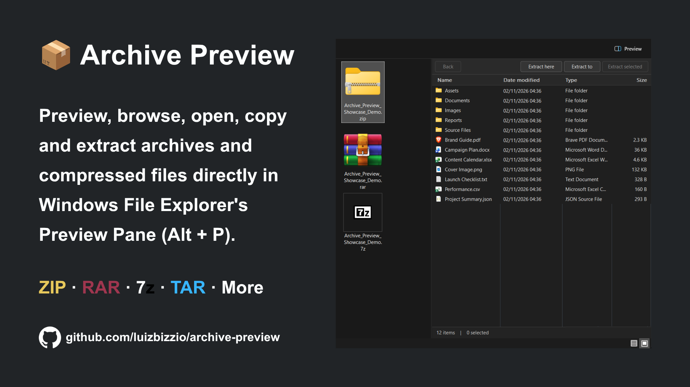

# Archive Preview

Browse, open, copy, and extract archives directly in **Windows File Explorer's Preview Pane (Alt + P)**, without opening a separate archive manager.

## Features

- **Browse archives:** View files and folders inside supported archives.
- **Open files:** Double-click a supported file to open it with its default Windows application.
- **Copy and paste:** Select items, press **Ctrl + C**, then paste them with **Ctrl + V**.
- **Drag and drop:** Drag files or folders out of the preview to **copy** them into File Explorer or a compatible application.
- **Extract archives:** Use **Extract here**, **Extract to**, or **Extract selected**. Selected items can also be extracted from the right-click menu.
- **Navigate folders:** Open folders inside an archive and click **Back** to return.
- **Windows 11 appearance:** Light and dark themes, familiar file icons, and optional Date modified, Type, and Size columns.
- **Native Windows integration:** Uses Windows Shell for archive access and file operations. There is no separate extraction engine or mod-managed disk cache.

## Installation

1. Install [Windhawk](https://windhawk.net/).
2. Find [Archive Preview](https://windhawk.net/mods/archive-preview) in Windhawk.
3. Click **Install** and enable the mod.
4. Open File Explorer, press **Alt + P**, and select a supported archive.

## Controls

| Action | How to use it |
| --- | --- |
| Open a folder or supported file | Double-click |
| Go back | Click **Back** |
| Select multiple items | **Ctrl** or **Shift** while selecting |
| Copy selected items | **Ctrl + C**, then **Ctrl + V** at the destination |
| Drag files out | Drag to File Explorer or a compatible application |
| Extract selected items | **Extract selected** or **Ctrl + Shift + E** |
| Extract to a chosen folder | **Extract to** |
| Extract beside the archive | **Extract here** |

**Ctrl + Shift + E** works only when the archive list has focus. You can change or disable this shortcut in the mod settings.

## Supported formats

| Enabled by default | Extension |
| --- | --- |
| ZIP | `.zip` |
| RAR | `.rar` |
| 7z | `.7z` |
| TAR | `.tar` |

**Optional experimental formats:** `.tar.gz`, `.tgz`, `.tbz`, and `.tzst`.

To try an experimental format, add its extension under **Windhawk Settings > Files / Archive extensions**. Support depends on your Windows version, file associations, and available Windows Shell providers. Some compound extensions also need a compatible preview association. Adding an extension does not install a missing archive provider.

**Windows 11 23H2 or newer** is recommended for native RAR, 7z, and TAR support.

## Settings

- **Archive extensions:** Choose which extensions Archive Preview handles.
- **Theme:** Follow Windows or select light or dark mode.
- **Columns:** Hide or show Date modified, Type, and Size.
- **Extract selected shortcut:** Change or disable the shortcut.
- **Allow preview for downloaded archives:** Off by default. Can relax a Windows preview check for certain local Internet-zone archives. It does **not** remove Mark of the Web. Keep it off for untrusted files.

## How it works

Archive Preview uses runtime hooks to redirect supported archive previews. It reuses the built-in Windows text Preview Handler in `prevhost.exe` and uses Windows Shell for file browsing, copying, drag and drop, and extraction.

It does **not** create or modify Windows Registry preview-handler registrations. The mod does not include its own archive extractor or create a managed disk cache for transfers. Windows Shell providers and other applications may still create temporary files.

## Compatibility and limitations

- **Local fixed drives:** Interactive operations require an archive stored on a local drive that Windows reports as fixed. Network shares, removable drives (including many USB drives), and paths containing junctions or symbolic links are not supported for opening, copying, dragging, or extracting. A read-only recovery list may still appear in some cases.
- **Windows providers:** Archive support depends on Windows Shell and the installed file associations. Some compression methods and password-protected archives may not work. There is no password prompt.
- **Copy and drag:** The mod forwards the Windows provider's native data objects. Some destination applications do not accept virtual files. Drag and drop requests a **copy**, not a move.
- **Clipboard lifetime:** A copied virtual selection may become unavailable after the mod or its broker is unloaded.
- **Opening risky files:** Direct opening of executable files, scripts, shortcuts, installers, and other selected risky file types is blocked. Extraction is a separate action. Only extract archives you trust.
- **Large archives:** A Shell provider may take time to load or extract files. Progress and cancellation are best effort, and an unresponsive provider can delay them.
- **Decompressed size:** Archive Preview does not enforce its own expanded-size limit during extraction. A small archive may expand into very large files.
- **Selection size:** Native transfer requests support up to **4,096 items** at once. Extracting an entire archive can also fail if more than 4,096 top-level items must be passed to the Shell provider.
- **Preview compatibility:** The runtime bridge requires the Windows text Preview Handler and compatible preview associations. Custom file associations or different Windows builds may behave differently.
- **Disable and unload:** The mod waits for active workers and Preview Host COM objects before unloading. If a provider stalls or a preview object remains open, disabling the mod may remain blocked until the Explorer window or Preview Host releases it. The mod never forces a process restart.

## Troubleshooting

**The preview does not appear**

Check that the Preview Pane is enabled with **Alt + P** and that the archive extension is included in the mod settings. Try opening the archive normally in File Explorer to confirm that Windows supports the format. The built-in Windows text Preview Handler must also be available.

**An action fails**

Copy, drag, open, and extract depend on the Windows provider and destination application. For experimental formats, support is not guaranteed. If an archive failed to load, select another file and return to the archive to retry.

**Problems after an update**

Close and reopen the File Explorer window. Archive Preview does not restart Explorer or Preview Host automatically.

**Report a bug**

[Open a GitHub issue](https://github.com/luizbizzio/archive-preview/issues) with your Windows version, archive format, steps to reproduce, and the result. Windhawk logs and screenshots can help. Remove private file names and paths before sharing logs.

## Author and license

Created by **[Luiz Bizzio](https://github.com/luizbizzio)**.

Licensed under **Apache License 2.0**. See [LICENSE](LICENSE).
