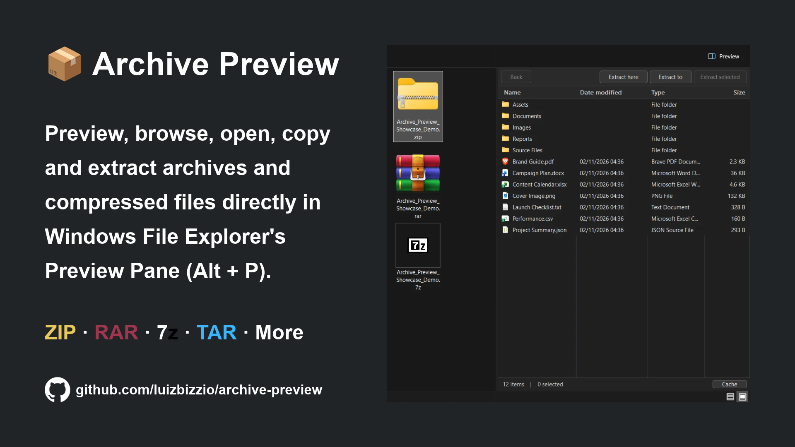

# Archive Preview

Browse, open, copy, and extract archives directly in **Windows File Explorer's Preview Pane (Alt + P)**, without opening a separate archive manager.

## Features

- **Browse archives:** View files and folders inside supported archives.
- **Open files:** Double-click a supported file to open it with its default Windows application.
- **Copy and paste:** Select items, press **Ctrl + C**, then paste them with **Ctrl + V**.
- **Drag and drop:** Drag files or folders out of the preview to **copy** them into File Explorer or a compatible application.
- **Extract archives** with Windows, 7-Zip, NanaZip, or WinRAR. Use **Extract here**, **Extract to…**, or **Extract selected** in the preview. You can also extract selected items from the right-click menu.
- **Navigate folders:** Open folders inside an archive and click **Back** to return.
- **Sort and resize columns** by clicking a column header or dragging its edge. Right-click a header to show or hide **Date modified**, **Type**, and **Size**. The mod saves your column widths and visibility.
- **Windows 11 appearance** with light and dark themes, familiar file icons, and selection highlighting based on your Windows accent color.
- **Preview languages** follow your Windows display language by default. You can also pick a language in Windhawk.
- **Native Windows integration** uses Windows Shell for browsing and clipboard transfers. You can use a supported external program for extraction and, optionally, dragging.

## Installation

1. Install [Windhawk](https://windhawk.net/).
2. Find [Archive Preview](https://windhawk.net/mods/archive-preview) in Windhawk.
3. Click **Install** and enable the mod.
4. Open File Explorer, press **Alt + P**, and select a supported archive.

## Controls

| Action | How to use it |
| --- | --- |
| Open a folder or supported file | Double-click |
| Go back | Click **Back** |
| Select multiple items | **Ctrl** or **Shift** while selecting |
| Copy selected items | **Ctrl + C**, then **Ctrl + V** at the destination. Windows handles the copy. |
| Drag files out | Drag to File Explorer or a compatible application |
| Extract selected items | Choose **Extract selected** and pick where to extract the selection. |
| Extract selected items beside the archive | Press **Ctrl + Shift + E**. |
| Extract to a chosen folder | Click **Extract to…**. The folder picker starts at the archive's location. |
| Extract beside the archive | **Extract here** |
| Sort the preview | Click a column header. Click it again to reverse the order. |
| Resize or hide columns | Drag a column edge to resize it. Right-click a header to choose which optional columns to show. |

**Ctrl + Shift + E** works only when the archive list has focus. You can set a separate shortcut for each of the four extraction actions in **Settings > Shortcuts**. Enter `disabled` to turn one off.

The list starts sorted by name and keeps folders first. Date and size columns sort by their values. The **Name** column gets priority when the preview pane is narrow.

## Supported formats

| Enabled by default | Extension |
| --- | --- |
| ZIP | `.zip` |
| RAR | `.rar` |
| 7z | `.7z` |
| TAR | `.tar` |

**Optional experimental formats:** `.tar.gz`, `.tgz`, `.tbz`, and `.tzst`.

To try an experimental format, add its extension under **Settings > Files and security > Archive extensions**. Support depends on your Windows version, file associations, and available Windows Shell providers. Some compound extensions also need a compatible preview association. Adding an extension does not install a missing archive provider.

**Windows 11 23H2 or newer** is recommended for native RAR, 7z, and TAR support.

## Settings

| Group | What you can change |
| --- | --- |
| **Files and security** | Choose the extensions Archive Preview handles. You can allow previews for some local archives marked as downloaded from the Internet. This exception is off by default and keeps Mark of the Web. |
| **Extraction** | Pick Windows, automatic external detection, 7-Zip, NanaZip, or WinRAR. You can set a program path and use that program when dragging files. |
| **Appearance** | Follow Windows or choose a light or dark theme. The preview follows your Windows display language by default and offers 105 languages and variants. Some messages use English when a translation is unavailable. |
| **Columns** | Show or hide **Date modified**, **Type**, and **Size**. You can hide the horizontal scrollbar and control date and size reads for large archives separately. |
| **Shortcuts** | Set or disable the four extraction shortcuts. |
| **Updates and disabling** | Optionally close Explorer windows that still contain an archive preview when the mod updates, recompiles, or is disabled. This is off by default. Enabling it closes all tabs in each affected window. |
| **Diagnostics** | Turn on **Detailed logs** and Windhawk logging to collect extra details for bug reports. **Detailed logs** is off by default. |

Reading dates and sizes is off by default for archives of **256 MiB or more**. When a value is unavailable, its cell stays blank. You can turn on either read in **Columns** for archives where you need it.

If you are updating from a version with ungrouped settings, copy your custom values from **Textual mode** before updating and reapply them in the relevant groups afterward.

## How it works

### Windows Shell and Preview Host

Archive Preview uses runtime hooks to redirect supported archive previews. It reuses the built-in Windows text Preview Handler in `prevhost.exe`. A broker inside `explorer.exe` manages the preview list and file operations. Windows Shell provides the archive contents, clipboard transfers, native dragging, and native extraction. The mod leaves Windows Registry preview-handler registrations in place.

### External extraction and drag and drop

Install 7-Zip, NanaZip, or WinRAR and select it in **Settings > Extraction**. The mod can find the program automatically. To set it manually, enter the path to `7zG.exe`, `NanaZipG.exe`, `NanaZip.Universal.Windows.exe`, or `WinRAR.exe`. External extraction keeps the paths stored in the archive. The external program shows its own progress, password, and overwrite dialogs where supported.

Turn on **Use the selected external program when dragging files** to use it for drag and drop. When the destination asks for the file data, the mod extracts the selection to a private temporary folder in its storage. Explorer then copies the files to the destination. The mod tries to remove the folder once the transfer releases it. On startup, the broker checks for leftovers and preserves folders that are still in use or whose status is unclear. Clipboard copy and paste use Windows.

## Compatibility and limitations

- **Local fixed drives:** Interactive operations require an archive stored on a local drive that Windows reports as fixed. Network shares, removable drives (including many USB drives), and paths containing junctions or symbolic links are not supported for opening, copying, dragging, or extracting. A read-only recovery list may still appear in some cases.
- **Portable Windhawk on USB** may be unable to use external dragging. The mod needs its own storage on a local drive that Windows reports as fixed.
- **Windows providers** determine which archives you can browse. Some compression methods and password-protected archives may fail to open in the pane. Windows browsing provides no password prompt.
- **Copy and drag** depend on the destination app. Some apps cannot receive virtual files. Drag and drop copies files to the destination. External dragging also needs enough free space for the temporary files.
- **Clipboard lifetime:** A copied virtual selection may become unavailable after the mod or its broker is unloaded.
- **Opening risky files:** Direct opening of executable files, scripts, shortcuts, installers, and other selected risky file types is blocked. Extraction is a separate action. Only extract archives you trust.
- **Large archives** may take time to load or extract. An unresponsive Windows provider can delay progress and cancellation. For some formats, Windows extraction can show 0% until it finishes.
- **Decompressed size:** Archive Preview does not enforce its own expanded-size limit during extraction. A small archive may expand into very large files.
- **Selection size:** Native transfer requests support up to **4,096 items** at once. Extracting an entire archive can also fail if more than 4,096 top-level items must be passed to the Shell provider.
- **Preview compatibility:** The runtime bridge requires the Windows text Preview Handler and compatible preview associations. Custom file associations or different Windows builds may behave differently.
- **Updates and disabling** wait for active workers and Preview Host COM objects. A stalled provider or an open preview can delay unloading. Close the Explorer window that showed the preview if Windhawk stays on **Uninitializing**. Hiding the Preview Pane may leave those objects open.

## Troubleshooting

**The preview does not appear**

Check that the Preview Pane is enabled with **Alt + P** and that the archive extension is included in the mod settings. Try opening the archive normally in File Explorer to confirm that Windows supports the format. The built-in Windows text Preview Handler must also be available.

**An action fails**

Try the same operation directly in File Explorer to check whether the Windows provider and destination app support it. If an archive failed to load, select another file and return to the archive to retry. For external extraction, check that the selected program is installed and that any path you set points to its graphical executable.

**Problems after an update**

If Windhawk stays on **Uninitializing**, close the Explorer window that showed the preview, then reopen it after the update. You can opt in to closing preview windows automatically under **Settings > Updates and disabling**.

**The file list stops working**

Archive Preview tries to rebuild the list from the data it already loaded and restore the last saved selection and scroll position. If rebuilding fails, it can switch to the Windows recovery list.

**Report a bug**

Enable Windhawk logging and **Settings > Diagnostics > Detailed logs** before reproducing the issue. Include your Windows version, archive format, extraction program, steps, and result. Use `[AP lifecycle]` for update or shutdown issues, `[AP list]` for list recovery, and `[AP external drag]` for drag and temporary file cleanup. Remove private file names and paths before sharing logs. [Open a GitHub issue](https://github.com/luizbizzio/archive-preview/issues)

## Author and license

Created by **[Luiz Bizzio](https://github.com/luizbizzio)**.

Licensed under **Apache License 2.0**. See [LICENSE](LICENSE).
